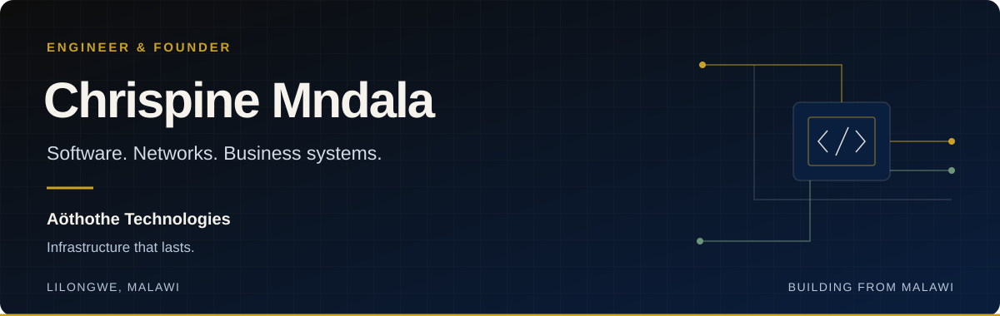

  

# Chrispine Mndala

**Software & systems engineer · Network technician · Founder, Aöthothe Technologies**

I build web applications, connected infrastructure and business workflows from Lilongwe, Malawi. My background combines software development, computer networks, data analysis, marketing and commercial operations. I bring those disciplines together to turn operational problems into practical systems.

**[Explore my portfolio](https://chrispine-portfolio.vercel.app)** · **[Aöthothe Technologies](https://aothothe-enterprise-os.vercel.app)** · **[Discuss a project](https://chrispine-portfolio.vercel.app/contact)**

## Selected projects & public previews

| Project | Purpose | Explore | Source |
| :--- | :--- | :--- | :--- |
| **Chrispine Portfolio** | Engineering work, project case studies and professional background | [Live portfolio](https://chrispine-portfolio.vercel.app) | [Repository](https://github.com/Chrispine-1210/ChrispinePortfolio) |
| **Aöthothe Technologies** | Technology services and the public introduction to an enterprise operations platform | [Public website](https://aothothe-enterprise-os.vercel.app) | Private |
| **BookingPro** | Appointment scheduling and service-provider workflows | [Live preview](https://appointments-booker-pi.vercel.app) | [Appointments-Booker](https://github.com/Chrispine-1210/Appointments-Booker) |
| **Thandizo Healthcare** | Healthcare, pharmacy and inventory workflows | [Live preview](https://health-care-management-system-mocha.vercel.app) | [Health-Care-Management-System](https://github.com/Chrispine-1210/Health-Care-Management-System) |

Public pages checked on 20 November 2026. Page availability does not establish payment activation, production readiness or verified business results. Protected workflows require authorized access.

### More work in development

| Project | Focus | Current public reference |
| :--- | :--- | :--- |
| **Mtendere Education Consult (MEC)** | Education consultancy, scholarships and administrative workflows | [Repository](https://github.com/Chrispine-1210/MEC) · Public preview availability needs rechecking |
| **Thoko Restaurant / CHL Investments** | Restaurant website, ordering and operational tools | [Repository](https://github.com/Chrispine-1210/CHL-INVESTMENTS) · Public preview access needs rechecking |
| **SUDERN** | Institutional and nonprofit operations | [Repository](https://github.com/Chrispine-1210/Sudern-ORG) · Separate project from Thandizo |

## Building Aöthothe Technologies

**Infrastructure that lasts.**

Aöthothe is the technology business I am building around enterprise software, managed IT services and business automation. The direction is practical: connect the public website, internal records, people and daily work in a system an organization can maintain.

| Area | Work I focus on |
| :--- | :--- |
| **Enterprise software** | Customer portals, admin workspaces, APIs and database-backed workflows |
| **Managed IT & networks** | Systems support, connectivity, maintenance and recovery planning |
| **Automation & reporting** | Operational dashboards, data collection and repeatable processes |
| **Delivery foundations** | Access controls, audit records, release verification and documentation |

The Enterprise OS is under development. Its public homepage is an introduction; internal operations and commercial activation follow their own verification and approval requirements.

## Engineering toolkit

| Discipline | Technologies & practice |
| :--- | :--- |
| **Interfaces** | TypeScript, React, Vite, Tailwind CSS, responsive UI, accessible interactions |
| **Services & data** | Node.js, Express, PostgreSQL, Drizzle ORM, Neon |
| **Infrastructure** | TCP/IP, routing, DNS, Cisco Packet Tracer, network troubleshooting |
| **Delivery** | Git, GitHub, Vercel, automated tests and deployment verification |
| **Business & analysis** | Excel, dashboards, monitoring & evaluation, project coordination |

Current engineering priorities include durable data, authentication, dependable communication, recovery and clear evidence of what a release actually supports.

## Connect

- **Base:** Lilongwe, Malawi · English & Chichewa
- **Work:** Full-stack development, network and systems support, business software, dashboards and automation
- **Portfolio:** [chrispine-portfolio.vercel.app](https://chrispine-portfolio.vercel.app)
- **Aöthothe:** [aothothe-enterprise-os.vercel.app](https://aothothe-enterprise-os.vercel.app)
- **LinkedIn:** [Chrispine Mndala](https://www.linkedin.com/in/chrispine-mndala-25b338236)
- **Project enquiries:** [Contact me](https://chrispine-portfolio.vercel.app/contact)
